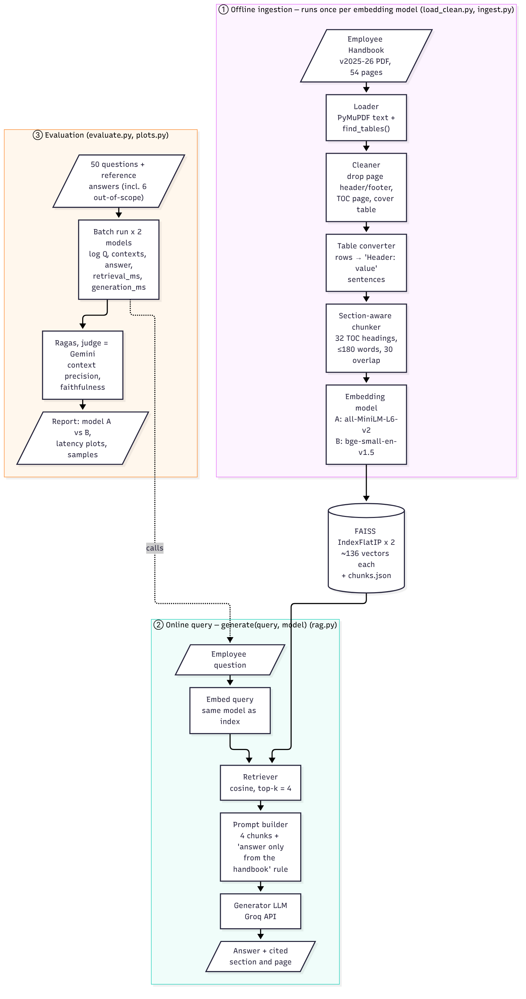

# Q&A on BOLD Employee Handbook — RAG pipeline

A Retrieval-Augmented Generation (RAG) system that answers employee questions from the company handbook, built from scratch in Python.

## Architecture
Full design, diagrams and decisions: [artifacts/architecture.md](artifacts/architecture.md)

| Stage | Tools |
|---|---|
| Load + clean | PyMuPDF (text + tables) |
| Chunk | Section-aware, ≤180 words, 30-word overlap, section-title prefix |
| Embed | `all-MiniLM-L6-v2` vs `bge-small-en-v1.5` (compared) |
| Store + retrieve | FAISS `IndexFlatIP`, top-k = 4 |
| Generate | Groq API |
| Evaluate | Ragas (context precision, faithfulness), Gemini as judge |

## Data
The handbook PDF is confidential and is **not** included in this repository. Place it at `data/handbook.pdf` to run the pipeline.

## Status
- [x] Architecture and diagrams
- [x] PDF loading and cleaning (`src/load_clean.py`)
- [ ] Chunking + embeddings + FAISS (`src/ingest.py`)
- [ ] Retrieval + generation (`src/rag.py`)
- [ ] Evaluation with Ragas (`src/evaluate.py`)
