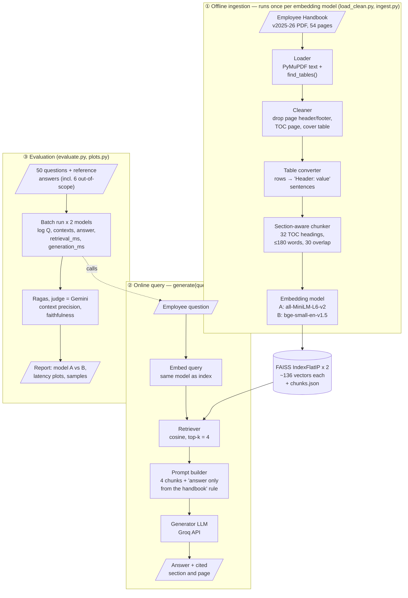
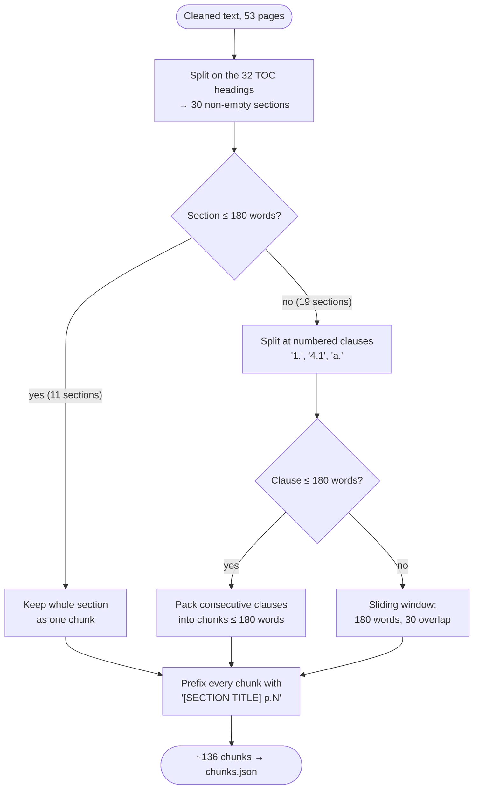
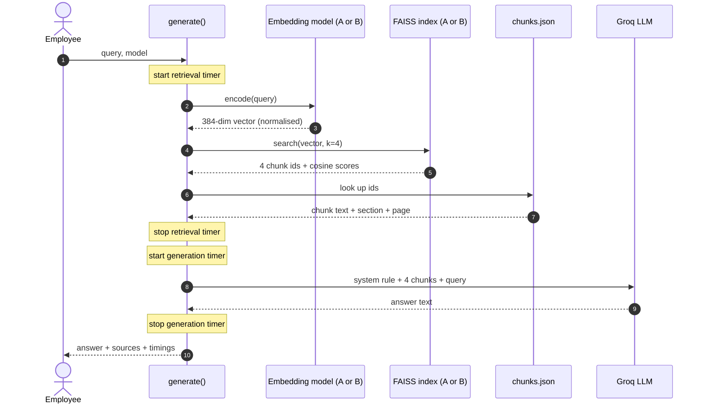
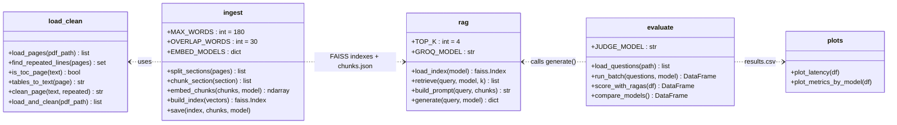

# System Architecture — Q&A on BOLD Employee Handbook (RAG)

Source document: *Employee Handbook v2025-26* — 54 pages, ~17,800 words, 32 TOC headings, 6 pages with tables.

| # | Diagram | Answers the question |
|---|---|---|
| 1 | Component diagram | What are the parts, and how does data flow through them? |
| 2 | Chunking activity diagram | How exactly is the handbook cut into chunks? |
| 3 | Sequence diagram | What happens, in order, when one question is answered? |
| 4 | Class diagram | How is the code organised? |

---

## 1. Component diagram

---

## 2. Chunking activity diagram

---

## 3. Sequence diagram — one call to `generate(query, model)`

---

## 4. Class diagram — code modules

---

## Design decisions and evidence from the handbook

| Decision | Value | Why (evidence from this handbook) |
|---|---|---|
| Loader | PyMuPDF + `find_tables()` | The PDF is born-digital (exported from Word), so no OCR is needed. 6 pages contain tables. |
| Cleaning | Remove repeated header, TOC page, cover table | Every page carries a letter-spaced header ("I n t e r n a l  u s e  o n l y …"). Without removal it appears in every chunk. The TOC page lists every section title, so it would match almost every query while containing no answers. |
| Tables | Convert each row to "Header: value" text; drop blank forms | Plain text extraction scrambles tables (e.g. shift allowance, travel booking deadlines, travel class by rank). Facts in these tables are likely test questions. The travel request form on p.26 is an empty template and is dropped. |
| Chunk boundaries | Section first (32 TOC headings), then numbered clauses | Section lengths vary from 61 to 2,603 words (median 266). One fixed window would cut short policies in half and mix two policies in one chunk. Policies are written as numbered clauses, which are natural break points. |
| Chunk size | ≤180 words (~240 tokens), 30-word overlap | `all-MiniLM-L6-v2` silently truncates input beyond 256 tokens. 180 words keeps every chunk under that limit, so the A/B comparison uses identical chunks for both models. The overlap keeps a rule intact when it crosses a boundary. |
| Section-title prefix | `[SHIFT POLICY] p.17 …` | "Scope" appears as a sub-heading 8 times and "Deviation/Exception" 11 times across different policies. Without the title, these chunks are indistinguishable. |
| Vector store | FAISS `IndexFlatIP`, one index per model | ~136 vectors: exact search is instant and runs in-process with no server. Comparing two models = two small index files. Chroma's metadata filtering and persistence add nothing for one static document. |
| Embeddings | Compare MiniLM vs bge-small (both 384-dim) | Same dimension and similar size, so the comparison isolates retrieval quality. Vectors are normalised, so inner product = cosine similarity. |
| top-k | 4 | A chunk is ~170 words, and most answers sit in one clause. 4 chunks (~700 words) cover questions that span clauses (e.g. leave types) without flooding the prompt. |
| Generator | Groq API | Fast, free tier, no local GPU. |
| Ragas judge | Gemini API | A different model from the generator, so the system does not grade its own answers. |
| Prompt rule | Answer only from the context; otherwise say "not in the handbook" | Raises faithfulness. 6 of the 50 test questions are deliberately out of scope to test this. |
